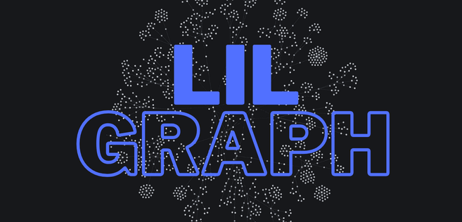

# LILGraph: Linked Intelligent Literature Graph

## What this project is

This repository contains a **work-in-progress agentic research engine** that turns large collections of scientific papers into a **navigable citation graph** and (via an MCP server) makes that graph accessible to LLM agents.

Instead of treating each paper as a single blob of text, the engine:

- Breaks papers into semantically meaningful pieces (sections, chunks, figures, equations, citations, etc.)  
- Connects those pieces within a paper and **across papers** via citation relationships  
- Lets agents **traverse, query, and reason** over this graph at a much finer level of granularity than “one PDF at a time”.

Everything here is experimental; APIs, formats, and naming may change.

---

## How it works (conceptually)

At a high level, the engine:

1. **Ingests papers from open repositories**  
   - Currently focused on arXiv: resolve from ID / DOI / title and download PDF / LaTeX sources.

2. **Parses the raw content into structure**  
   - Uses configurable parsing pipelines to extract:
     - Document structure (sections, paragraphs, display math, etc.)  
     - Assets (figures, tables, algorithms, images)  
     - Bibliography entries and in-text citations.

3. **Builds a document graph**  
   - Each relevant unit (paper, section, text chunk, figure, citation, etc.) becomes a **node**.  
   - Edges capture both:
     - Intra-paper structure (e.g. “section has child paragraph”, “paragraph refers to figure”)  
     - Cross-paper links (e.g. “this chunk cites that paper’s graph”).

4. **Expands citations in parallel**  
   - A level-wise process:
     - Processes a frontier of papers in parallel (download → parse → build graph → persist).  
     - Resolves all citations for that level together (CrossRef, arXiv, etc.), de-duplicated across papers.  
     - Schedules cited papers as the next frontier when they can be expanded safely.  
   - When a cited paper cannot be parsed, the citation is **left in place** and clearly marked as non-expandable.

5. **Persists and updates the graph**  
   - Stores the graph in a backing graph database (Neo4j today), plus JSON snapshots per paper.  
   - As citation metadata improves or new papers are ingested, **nodes and edges are updated**, so the graph remains live and incrementally refined (not a static dump).

6. **Surfaces the graph via MCP**  
   - The engine is intended to run as (or behind) an MCP server, so LLM agents can:
     - Ask for local neighborhoods around a claim, equation, or figure  
     - Walk forward/backward along citation paths  
     - Compare related experiments, proofs, or algorithms across multiple papers.

---

## Roadmap (planned / in progress)

These are directional goals; you can keep or drop whichever ideas you like.

### Data sources & coverage

- Expand beyond arXiv to other **open repositories**, for example:
  - bioRxiv / medRxiv  
  - domain repositories such as ACL Anthology or OpenReview  
  - institutional and publisher-hosted open-access collections.
- Support hybrid ingestion where PDFs, HTML, and JATS/XML all normalize into the same graph schema.

### Parsing & representation

- Add **DL-based PDF→graph** pipelines (alongside LaTeXML / Pandoc), using models such as:
  - Meta Nougat  
  - DeepSeek-OCR  
  - Other layout-aware or multimodal parsers.
- Improve extraction of:
  - Logical structure (claims, definitions, lemmas, proofs)  
  - Tables and figures with machine-readable semantics (not just images)  
  - Code and pseudo-code blocks as first-class graph nodes.
- Make it easy to plug in new parsers without changing the rest of the system.

### Retrieval & reasoning

- Incorporate **optional embedding-based similarity search** on top of the graph, for example:
  - Vector indexes for chunks, formulas, figures, or code snippets  
  - Hybrid “graph + vector” queries (e.g. “methods similar to this section that also cite X”).  
- Let agents:
  - Build and reuse “research journeys” (saved paths/subgraphs)  
  - Generate mini-surveys and comparisons from neighborhoods in the graph.

### Agentic graph operations (ideas)

- Use LLMs to **refine citation context**, for example:
  - When a text chunk has many citation children, synthesize a query that pinpoints which specific sections/nodes in the cited papers are most relevant, then connect those nodes explicitly.
- Investigate ways to **connect seemingly unrelated papers**, such as:
  - Concept-level links inferred from text and embeddings  
  - Shared methods, datasets, experimental setups, or evaluation metrics.

### MCP & tooling

- Harden the **MCP surface**:
  - Well-scoped tools for ingestion, expansion, and querying  
  - Resource views that are easy for agents to consume and summarize (e.g. “local neighborhood around this node”, “all outgoing/incoming `CITES_GRAPH` edges”, etc.).
- Provide example agents / scripts that demonstrate:
  - Deep dives into a single paper and its immediate neighborhood  
  - Cross-paper comparisons (e.g. “baseline vs. SOTA over time for task T”)  
  - Building structured literature reviews by traversing and sampling the graph.

---

## Status

- The project is **early-stage and experimental**.  
- Core flows for:
  - arXiv ingestion  
  - graph building  
  - parallel citation expansion  
  - and graph persistence  
  are already in place and evolving.